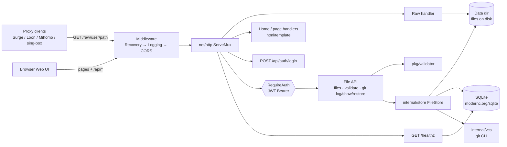

# surge-host

English | [简体中文](README.zh-CN.md)

[](https://github.com/AsaqeLee/surge-host/actions/workflows/ci.yml)
[](go.mod)
[](LICENSE)
[](https://github.com/AsaqeLee/surge-host/commits/main)

Self-hosted Go service for hosting, versioning, and validating proxy configuration files. Deliver Surge, Loon, Meta/Mihomo, and sing-box configs through stable Raw URLs.

```text
https://your-domain.com/raw/{user}/{filename}
```

**Project status (2026-07-01):** Feature development is complete at v2.4.1. A maintained deployment runs at [rules.asaqe.site](https://rules.asaqe.site). See [CHANGELOG.md](CHANGELOG.md).

## Overview

Proxy rules and client configs need a stable plain-text HTTP endpoint—no HTML wrappers, controlled writes, and client-side sync.

| Capability | Description |
|------------|-------------|
| Raw URL | Plain-text delivery for rule lists, YAML, JSON, and related files |
| Web UI | Upload, file list, online editor with syntax highlighting |
| Git versioning | Per-file history, preview, and rollback |
| Validation | Format-level / heuristic checks before publish |
| Docker | Deploy via Compose on NAS, VPS, or homelab |

### Supported formats

| Extension | Client / use case | Validation |
|-----------|-------------------|------------|
| `.list` | Surge / Loon rule sets | Rule-line syntax |
| `.conf`, `.module` | Surge configuration | Section and rule checks |
| `.plugin`, `.lpx` | Loon plugins | Plugin sections |
| `.yaml`, `.yml` | Meta / Mihomo | YAML syntax + structure |
| `.json` | sing-box | JSON syntax + top-level structure |
| `.txt` | Plain text | None |

Validation is heuristic, not a full upstream schema parser.

## Architecture



## Requirements

- Go 1.26+ for local builds (see `go.mod`)
- Docker / Docker Compose for the recommended deploy path
- SQLite (embedded) and optional Git tooling as used by the service

## Getting started

### Docker (recommended)

```bash
git clone https://github.com/AsaqeLee/surge-host.git
cd surge-host
cp .env.example .env
# set domain, admin password, JWT secret
docker compose up -d --build
```

After changing `web/` templates or static assets, rebuild before recreate. A container-only restart does not refresh baked-in frontend files.

### Local development

```bash
go mod tidy
go run ./cmd/server
```

Default: `http://localhost:8080`

When `SURGE_HOST_DOMAIN` is not loopback, startup requires a non-empty admin password and a non-default JWT secret.

## Configuration

| Variable | Description |
|----------|-------------|
| `SURGE_HOST_DOMAIN` | Public domain for Raw URL generation |
| `SURGE_HOST_ADMIN_USER` | Dashboard admin username |
| `SURGE_HOST_ADMIN_PASSWORD` | Required for non-loopback deployments |
| `SURGE_HOST_JWT_SECRET` | JWT signing secret |
| `SURGE_HOST_ALLOWED_EXTENSIONS` | Allowed file types |
| `SURGE_HOST_VALIDATE_ENABLED` | Toggle validation |
| `SURGE_HOST_GIT_ENABLED` | Toggle Git versioning |

See `.env.example` for the full list.

## Integration

Raw URL examples:

```text
https://your-domain.com/raw/user/rules.list
https://your-domain.com/raw/user/meta.yaml
https://your-domain.com/raw/user/sing-box.json
```

**Surge** — in `surge.conf`:

```ini
[Rule]
RULE-SET,https://your-domain.com/raw/user/rules.list,PROXY
```

Meta/Mihomo and sing-box clients can subscribe to the corresponding Raw URLs. Loon can import `.list` rule sets and `.plugin` / `.lpx` plugins by URL.

### REST API (summary)

| Endpoint | Description |
|----------|-------------|
| `GET /healthz` | Dependency health |
| `GET /api/files` | List files |
| `POST /api/files` | Upload |
| `PUT /api/files/{path}` | Replace content |
| `POST /api/validate` | Dry-run validation |
| `GET /api/git/log/{path}` | Version history |

Authenticated endpoints require `Authorization: Bearer <token>` from `POST /api/auth/login`.

## Web UI

| Path | Purpose |
|------|---------|
| `/` | Overview and public registry |
| `/upload` | Upload |
| `/files` | Manage files, Raw URLs, history |
| `/edit/{path}` | Online editor |

## Project layout

```text
cmd/server/
internal/
pkg/
web/
docker-compose.yml
Dockerfile
```

## Tests

```bash
go vet ./...
go test -race ./...
```

CI (`.github/workflows/ci.yml`) runs vet, race tests, build, pinned `govulncheck`, and a Docker build on every push to `main`.

## Status / limitations

Final feature release declared in CHANGELOG; treat further work as maintenance.

## License

MIT. See [LICENSE](LICENSE).
